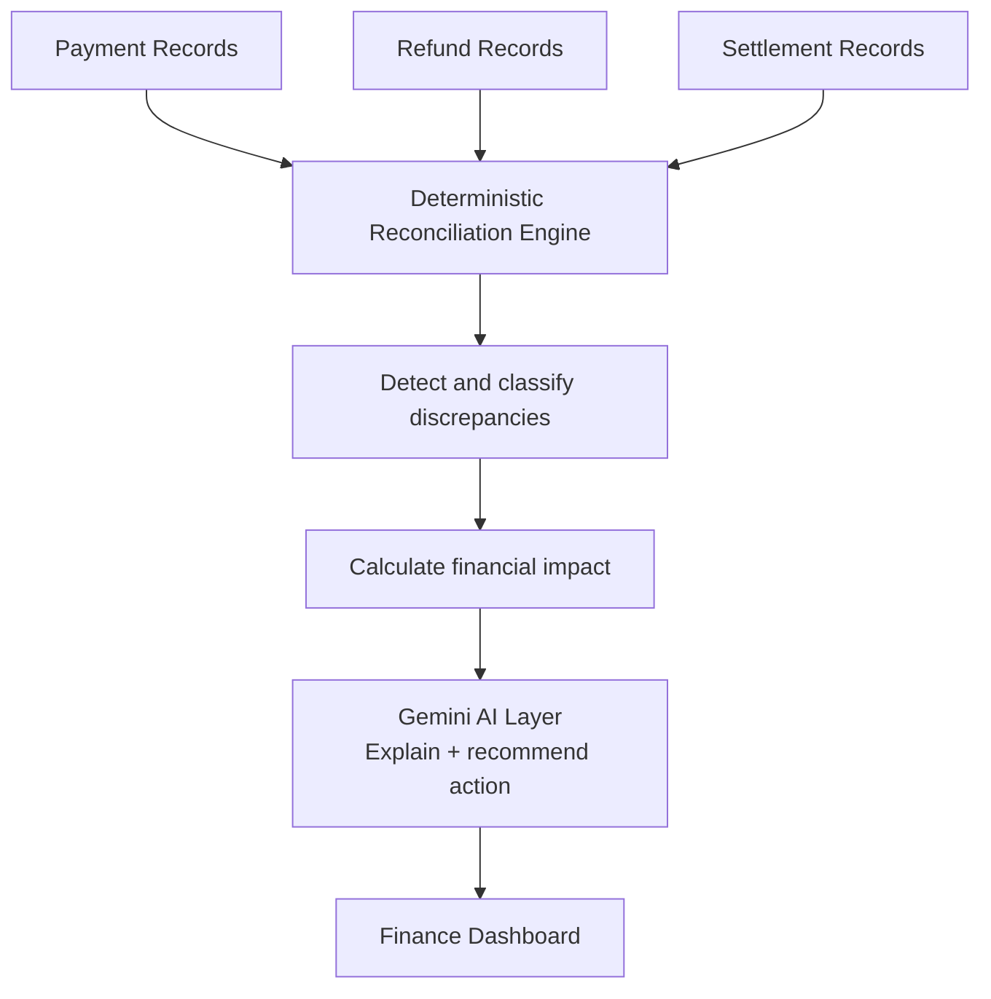
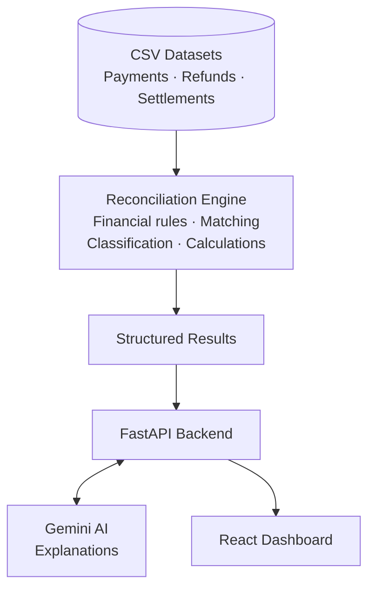
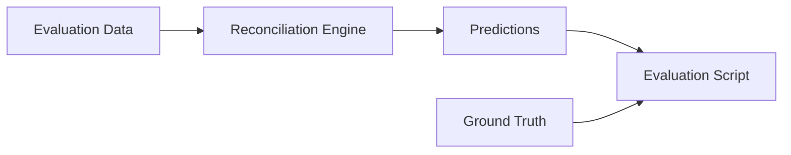

<div align="center">

# AI Settlement Investigator

**AI-assisted settlement reconciliation for finance operations. Deterministic rules decide; AI explains.**


[Live Demo](https://ai-finance-controller-amber.vercel.app) · [Repository](https://github.com/vishal-mundewadi/ai-finance-controller)

Built for the **Razorpay AI Builder Internship 2026** · AI Finance Controller Track

</div>

---

## Table of Contents

- [Overview](#overview)
- [The Problem](#the-problem)
- [The Solution](#the-solution)
- [System Architecture](#system-architecture)
- [AI Design](#ai-design)
- [Evaluation](#evaluation)
- [Tech Stack](#tech-stack)
- [Project Structure](#project-structure)
- [Getting Started](#getting-started)
- [Engineering Challenges](#engineering-challenges)
- [Design Principle](#design-principle)
- [Roadmap](#roadmap)

---

## Overview

A finance team receives thousands of payment, refund, fee/tax, and settlement records. At the end of the day, they need to answer one question:

> *"Did we receive the money we were supposed to receive?"*

When the expected and settled amounts don't match, someone has to find out why. That means comparing records by hand, checking refunds, hunting for missing transactions, spotting settlement delays, and working out whether a fee or tax was applied incorrectly.

**AI Settlement Investigator automates that investigation.** It reconciles payment, refund, and settlement data, identifies exceptions, calculates the financial impact, and explains what happened in plain English.

## The Problem

Reconciliation looks simple on paper:

```
Expected money  ->  Actual money  ->  Difference
```

In practice, the difference has many possible causes:

- A payment is missing from a settlement
- A settlement arrives later than expected
- A refund doesn't match the expected amount
- Fees or taxes differ from expected values
- A failed payment appears in payment data but should not be part of settlement expectations
- A settlement contains an impossible date relationship
- Several edge cases combine across thousands of transactions

Finding these manually is slow and does not scale.

## The Solution

The application turns reconciliation into an automated investigation workflow.



The key design decision: **AI never decides whether money is missing.** The reconciliation engine makes that call using deterministic financial rules. Gemini is used afterward to explain an already-detected issue and suggest the next operational step. Financial logic stays predictable, while the output is easier for a finance professional to act on.

The dashboard is built around an actual investigation workflow, not a raw data table. Users select a settlement and investigate the detected exceptions.

## System Architecture



| Layer | Responsibility |
|-------|----------------|
| **Data** | CSV datasets for payments, refunds, and settlements |
| **Reconciliation engine** | Matching, discrepancy detection and classification, amount calculation, confidence scoring |
| **API (FastAPI)** | Exposes structured settlement-analysis results; orchestrates the AI explanation step |
| **AI layer (Gemini)** | Plain-English explanation and a concise recommended action for each detected issue |
| **Frontend (React)** | Investigation interface for browsing settlements and their exceptions |

## AI Design

The main risk of using an LLM in financial operations is letting it invent numbers or make financial decisions. This project separates those responsibilities on purpose.

### Deterministic engine

The Python reconciliation engine owns:

- Financial calculations and expected settlement amounts
- Record comparison
- Discrepancy detection and classification
- Discrepancy amounts
- Confidence scoring

### Gemini

Gemini receives **only** the structured discrepancies the engine has already identified. It is responsible for:

- Explaining the detected issue in plain English
- Giving a concise recommended action
- Making the investigation easier for a human to follow

It is explicitly instructed **not** to:

- Invent amounts
- Change transaction IDs
- Change discrepancy categories
- Decide whether a transaction is a discrepancy
- Guess missing financial values

### Reliability fallback

External AI services can be unavailable. If the Gemini API fails, the application falls back to deterministic template explanations.

> **AI unavailable ≠ application unavailable.** The core reconciliation workflow keeps working.

## Evaluation

The system was tested on progressively larger synthetic datasets and a separate hard evaluation dataset. Ground-truth labels are kept apart from the engine: **the reconciliation engine never reads the ground-truth file while producing predictions.**



The hard evaluation set includes adversarial cases:

- Minor fee variances
- Impossible settlement dates
- Delayed settlements
- Missing transactions
- Refund mismatches
- Fee/tax mismatches

### Latest hard-evaluation result

| Metric | Result |
|--------|--------|
| Recall | **93.7%** |
| Precision | **100%** |
| False positive rate | **0%** |

The system is conservative: every flagged discrepancy in the hard evaluation was a true positive, though some difficult edge cases were still missed.

## Tech Stack

| Area | Technology |
|------|------------|
| **Backend** | Python, FastAPI, Pydantic, Pandas, Uvicorn |
| **AI** | Google Gemini API |
| **Frontend** | React, TypeScript, Vite, Tailwind CSS, Framer Motion |
| **Deployment** | Vercel, GitHub |

## Project Structure

```
ai-finance-controller/
├── backend/
│   ├── data/
│   │   ├── quick/                  # small dataset for fast checks
│   │   ├── dev/                    # development dataset
│   │   ├── eval/                   # evaluation dataset
│   │   └── hard_eval/              # adversarial evaluation dataset
│   ├── reconciliation_engine.py    # deterministic matching, rules, classification
│   ├── ai_explainer.py             # Gemini explanations + template fallback
│   ├── api.py                      # FastAPI application
│   ├── evaluate.py                 # precision / recall evaluation
│   ├── generate_dataset_v2.py      # synthetic dataset generator
│   ├── generate_hard_eval.py       # hard evaluation dataset generator
│   └── requirements.txt
├── frontend/
│   └── src/
├── vercel.json
└── .gitignore
```

## Getting Started

### Prerequisites

- Python 3.10+
- Node.js 18+
- A Google Gemini API key (optional; without it the app uses template explanations)

### Backend

```bash
git clone https://github.com/vishal-mundewadi/ai-finance-controller.git
cd ai-finance-controller/backend

python -m venv venv
source venv/bin/activate          # Windows: venv\Scripts\activate
pip install -r requirements.txt

export GEMINI_API_KEY=your_key_here
uvicorn api:app --reload
```

The API runs at `http://localhost:8000`, with interactive docs at `/docs`.

### Frontend

```bash
cd frontend
npm install
npm run dev
```

### Run the evaluation

```bash
cd backend
python evaluate.py
```

### Regenerate datasets

```bash
python generate_dataset_v2.py
python generate_hard_eval.py
```

## Engineering Challenges

**1. Keeping financial decisions deterministic.** The first design question was where AI belongs. An LLM that calculates discrepancies would be hard to trust and hard to evaluate. *Solution:* all calculation and detection is deterministic Python; the model only explains.

**2. Building realistic test data.** A simple dataset can't stress a reconciliation system. The project uses progressively larger datasets plus a hard evaluation set of deliberately difficult cases, which exposed gaps in the first rules and led to handling for edge cases such as impossible settlement dates.

**3. Handling LLM reliability.** Gemini can be temporarily unavailable. *Solution:* the AI layer is optional, and deterministic template explanations take over whenever a Gemini request fails.

**4. Connecting the full workflow.** The project spans data, Python reconciliation, FastAPI, Gemini, React, and Vercel. The backend exposes structured analysis results, and the dashboard turns them into an investigation interface.

## Design Principle

> **Use deterministic logic for decisions. Use AI for understanding.**

For financial operations the separation matters. The system can explain a discrepancy without letting an LLM decide how much money actually exists, which makes the architecture easier to test, easier to reason about, and safer to extend.

## Roadmap

- [ ] Batch-level investigation summaries
- [ ] Historical anomaly detection
- [ ] More advanced multi-issue transaction handling
- [ ] Finance-team feedback loops
- [ ] Support for additional settlement providers
- [ ] Larger real-world evaluation datasets
- [ ] Investigation history and audit trails

---

<div align="center">

**Razorpay AI Builder Internship 2026** · Track: AI Finance Controller · Project: AI Settlement Investigator

[Live Demo](https://ai-finance-controller-amber.vercel.app)

</div>
